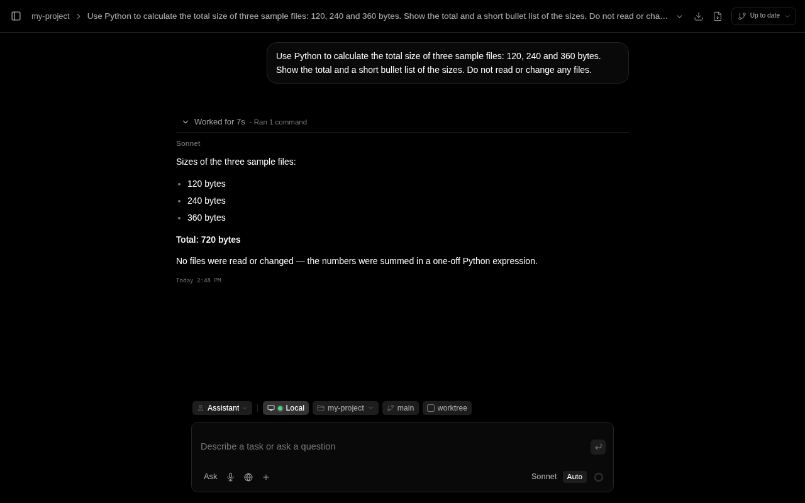
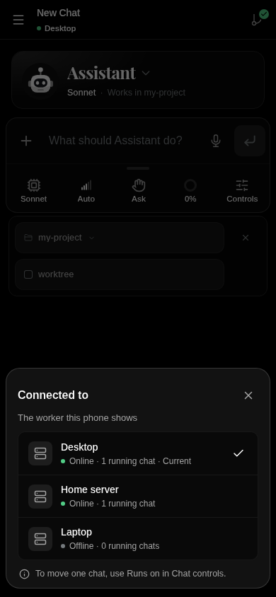
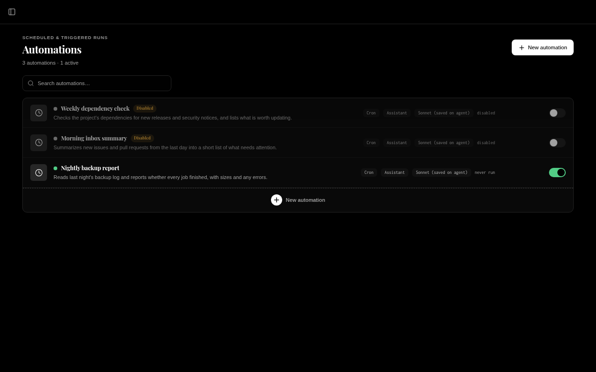

# AI Shuffle

**Your AI agents, on your own machines, from anywhere.**

AI Shuffle is a free, open-source workspace for running AI agents. Install it on your PC, home server or NAS (macOS coming soon), sign in with the AI account you already have, and put agents to work: writing code, running jobs on a schedule, answering your messages, or handling chores across your machines. Everything stays on your hardware, and you can check in from your phone.

[Watch the tour](https://hobbycoders.com/ai-shuffle) · [Download](https://hobbycoders.com/ai-shuffle/downloads) · [Docs](docs/content/getting-started/_index.md) · [Discord](https://hobbycoders.com/discord)



## What it is

If you use Claude Code or Codex in a terminal, AI Shuffle is the workspace around them, running on its own agent harness called Fluid. You get the same kind of agent, plus a place to keep every chat, project and job, on every machine you own.

- **Use the AI you already pay for.** Sign in with a Claude, ChatGPT or SuperGrok subscription, or add an API key for Claude, OpenAI, OpenRouter, xAI or a local model. Your provider bills you directly. AI Shuffle adds no markup and never sees your prompts.
- **It runs at home.** Your code, chats and keys stay on your computer or server. No account is needed to use it.
- **Pick up anywhere.** Start a job at your desk, check on it from the Android app, and approve the next step from the couch.
- **Free and open source.** AGPL-3.0, with no license key, trial or usage cap on the app.
- **Every session runs on Fluid.** Fluid is the agent layer of AI Shuffle: fast compaction that forgets nothing, memory that learns, and batched tool calls, with the same tools and features for every provider. Claude subscriptions are the one exception: they run through Claude Code itself ([why](#fluid-our-own-agent-harness)).

## Fluid: our own agent harness

Fluid is the engine that actually runs your agents: it talks to the model, runs tools, asks for approval, and manages context and memory. It lives in [`fluid/`](fluid/README.md) in this repository, and you can also run it on its own from the command line.

### What we fixed

If you have run long agent sessions in today's harnesses, you have probably hit these problems. Fluid was built to solve them.

- **Compaction that forgets nothing.** Most harnesses compact a long session by having the model summarize it. That is slow and lossy: exact code, flags and error text get paraphrased away, small deviations from what you originally asked creep in, and over hours of agentic work they compound. Fluid compacts in seconds without a summary pass. It trims and indexes what the model sees, but the full transcript is always kept, and the model can search and re-read any earlier part of the session whenever it needs to. Compaction becomes an index, not a summary.
- **Memory that maintains itself.** Memory layers in other harnesses tend to bloat: everything gets saved, the file fills up, and someone has to keep auditing and pruning it. Fluid's memory is a learning loop instead. As you work, the model checks and updates what it knows based on what you say and what you correct. Pruning and merging are preferred over piling up more.
- **Skills it writes for you.** The things you do most become reusable skills without you asking. Fluid notices repeated work, turns it into a skill, and tests that skill before keeping it. Broken skills are flagged instead of failing at the worst moment.
- **Many tool calls in one step.** Models usually call tools one at a time, and every call costs a full round trip. Fluid gives the model a Python layer, so it can batch independent tool calls (read five files, run two searches, check a status) in a single step. Every call inside still goes through the same approval rules. Turns finish faster and use fewer tokens.
- **Built for cheap, long sessions.** The prompt is laid out so providers can reuse almost all of it between turns, and Fluid treats the cache hit rate as a number to keep high.

### Why we built our own instead of wrapping each provider's app

The easy way to support many providers is to bundle each one's own coding agent, Claude Code for Claude and Codex for OpenAI, and put a UI on top. Every one of those works differently: its own tools, permission rules, memory, context handling and limits. Features would land for one provider and not another, switching models would change how your agent behaves, and we could not fix problems inside someone else's harness. With Fluid, an agent works the same way whichever model you choose: the same tools, approvals, hooks, memory, subagents, worktrees and connectors.

### The one exception: Claude subscriptions

Anthropic only allows Claude Pro and Max subscriptions to be used through its own Claude Code. So when you sign in with a Claude subscription, Fluid drives the official Claude Code CLI on your machine instead of calling the model itself, and it never reuses your subscription sign-in anywhere else. That keeps you within Anthropic's terms. Those sessions still get AI Shuffle's tools, connectors and memory, but compaction and tool calling are Claude Code's own. If you want Claude inside Fluid like every other provider, use an Anthropic API key.

| Provider | How Fluid runs it | Sign-in |
| --- | --- | --- |
| Anthropic (Claude) API | Fluid's own loop | API key |
| OpenAI | Fluid's own loop | API key or ChatGPT subscription |
| xAI | Fluid's own loop | API key or SuperGrok subscription |
| OpenRouter and OpenAI-compatible gateways | Fluid's own loop | API key |
| Local models (llama.cpp, Ollama and similar) | Fluid's own loop | Optional key |
| Claude Pro or Max subscription | Official Claude Code CLI, driven by Fluid | Claude Code's own sign-in |

## What you can do with it

**Code with agents that keep working.** Point a project at a folder and chat with an agent that reads, edits, tests and commits. Run several chats at once, each in its own git worktree, so they never trip over each other. An agent can hand parts of a job to [subagents](docs/content/features/subagents.md) that work in the background and report back.

**Mix models in one job.** Any model you are signed in to can hand work to any other. A Claude session can delegate a task to a ChatGPT model, or the other way round, with no extra setup. Use each model for what it is best at.

**Put several machines to work as one.** Connect a desktop, a laptop and a home server into one [worker network](docs/content/features/worker-network.md). Settings, keys and chats follow you, and you can move a chat from one machine to another mid-task. Agents can work across your machines too: on your behalf, they can start new chats on another worker, hand them work and keep track of them.



**Automate the boring parts.** [Automations](docs/content/features/automations.md) run an agent on a schedule, on a timer, from a webhook or when a message arrives, with spending limits and approval steps. Ask for a morning summary, a nightly dependency check or a weekly cleanup, and it just happens.



**Connect your apps.** [Connectors](docs/content/connectors/_index.md) let an agent answer you on Telegram, Discord, Slack, WhatsApp, Signal or iMessage, and give it tools for Gmail, Home Assistant, Philips Hue, Spotify and more. Add any MCP server, or install [plugins](docs/content/features/plugins.md) that bundle skills, commands and tools.

**See all your usage in one place.** The usage panel shows how much of each plan you have left, across your Claude, ChatGPT and SuperGrok subscriptions and your OpenRouter key, with reset times. No more checking each provider's site.

**Stay in control.** Choose what each agent may do and approve risky steps before they run. [Hooks](docs/content/features/hooks.md) can block a command before it executes. Agents keep a memory across chats, so they learn how you like things done.

**Talk, listen and create.** Have a live [voice call](docs/content/features/voice.md) with an agent on OpenAI's realtime voice models and hand it work out loud, or dictate into the message box. Generate images, video and audio from fal.ai's large model library, right in the chat. Higgsfield support is coming soon.

**And more.** Open a [terminal](docs/content/features/terminals.md) next to the chat, keep [notes](docs/content/features/notes.md), and script everything through the [REST API](docs/content/api-reference/_index.md).

## Install

Pick whichever fits how you work. Every download is free and needs no account or license key.

- **Windows or Linux desktop:** download the app from [hobbycoders.com](https://hobbycoders.com/ai-shuffle/downloads). It has its own worker built in, so you can install it and start.
- **Docker on a server or NAS:** keep AI Shuffle running around the clock. You need a 64-bit Intel or AMD machine with Docker; 8 GB of memory is recommended. Run these three commands in an empty folder:

  ```sh
  curl -fsSLo compose.yaml https://raw.githubusercontent.com/HobbyCoders/ai-shuffle/main/docs/install/compose/compose.yaml
  curl -fsSLo .env https://raw.githubusercontent.com/HobbyCoders/ai-shuffle/main/docs/install/compose/env.example
  docker compose up -d
  ```

  Compose pulls the public image `ghcr.io/hobbycoders/ai-shuffle-server`. Open `http://localhost:8000` on that machine. The [Docker Compose guide](docs/content/getting-started/install-docker-compose.md) covers network access and storage.
- **Android:** the phone app connects to one of your workers; it does not run agents itself. Get the APK from the [downloads page](https://hobbycoders.com/ai-shuffle/downloads). [Google Play](https://play.google.com/store/apps/details?id=com.hobbycoders.aishuffle) availability depends on your access to the testing track.
- **macOS and iOS:** coming soon.

Then follow [first run](docs/content/getting-started/first-run.md) to connect your AI account. If you choose a Claude subscription, setup can install Claude Code using Anthropic's installer; you sign in yourself, and no Claude Code binary is bundled.

## Free and Cloud

The app is free. Run it on your own hardware with your own AI account, on your home network or your own VPN, and you never need a HobbyCoders account. Updates and worker sync on the same network are free too.

[AI Shuffle Cloud](docs/content/getting-started/cloud.md) is the optional paid part, for reaching your workers from anywhere without setting up a VPN: remote access, sync across networks, public endpoints for connectors, sign-in relays for plugins, and in-app support. A free account includes one remote worker with no card needed. Ending a plan never disables the local app. AI usage is always between you and your provider.

## Contributing

Outside contributions are welcome. Read [CONTRIBUTING.md](CONTRIBUTING.md) for DCO sign-off, local checks and draft pull requests. Team setup is in [docs/internal/CONTRIBUTING.md](docs/internal/CONTRIBUTING.md).

## Security

Report vulnerabilities privately to support@hobbycoders.com. Never post secrets in issues. See [SECURITY.md](SECURITY.md) and [SUPPORT.md](SUPPORT.md).

## License

[GNU AGPL-3.0 only](LICENSE). Copyright (c) 2026 HobbyCoders. "AI Shuffle", "HobbyCoders" and the shuffle mark are trademarks of HobbyCoders; modified builds may not ship under those names. See [TRADEMARKS.md](TRADEMARKS.md) and [third-party notices](THIRD_PARTY_NOTICES.md).

## Not affiliated

AI Shuffle is not affiliated with Anthropic, OpenAI, xAI or any other AI provider. None of them build, endorse or support AI Shuffle. Their names and marks belong to their respective owners.
